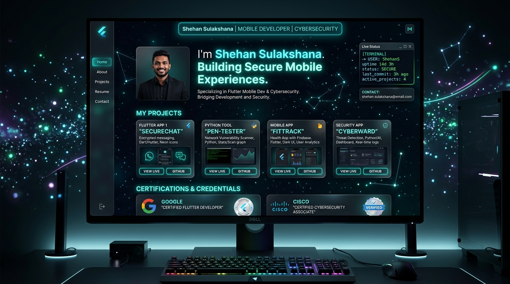

# Shehan Sulakshana

Personal portfolio showcasing my mobile development and cybersecurity work.

[Live Website](https://shehan-sulakshana.is-a.dev/) · [GitHub](https://github.com/ShehanSulakshana) · [LinkedIn](https://www.linkedin.com/in/shehan-sulakshana-129758342) · [Email](mailto:shehansulakshana01@gmail.com)

---

## Preview



---

## About

I am an Information Technology undergraduate at the Open University of Sri Lanka with a focus on cross platform mobile development using Flutter and Dart. Alongside application development, I actively study cybersecurity, network security protocols, and defensive software engineering.

This repository contains the source code for my portfolio website.

---

## Built With

- React and TypeScript
- Tailwind CSS
- Vite
- Supabase

---

## Getting Started

### Prerequisites

- Node.js (v18 or higher recommended)
- npm

### Installation

1. Clone the repository:
   ```bash
   git clone https://github.com/ShehanSulakshana/ShehanSulakshana.github.io.git
   ```

2. Navigate into the project directory:
   ```bash
   cd ShehanSulakshana.github.io
   ```

3. Install dependencies:
   ```bash
   npm install
   ```

4. Run the local development server:
   ```bash
   npm run dev
   ```

5. Build for production:
   ```bash
   npm run build
   ```

---

## Contact

- **Email:** shehansulakshana01@gmail.com
- **LinkedIn:** [linkedin.com/in/shehan-sulakshana-129758342](https://www.linkedin.com/in/shehan-sulakshana-129758342)
- **GitHub:** [github.com/ShehanSulakshana](https://github.com/ShehanSulakshana)
- **WhatsApp:** [+94 71 314 3118](https://wa.me/+94713143118)

---

<sub>© Shehan Sulakshana. Released under the MIT License.</sub>
